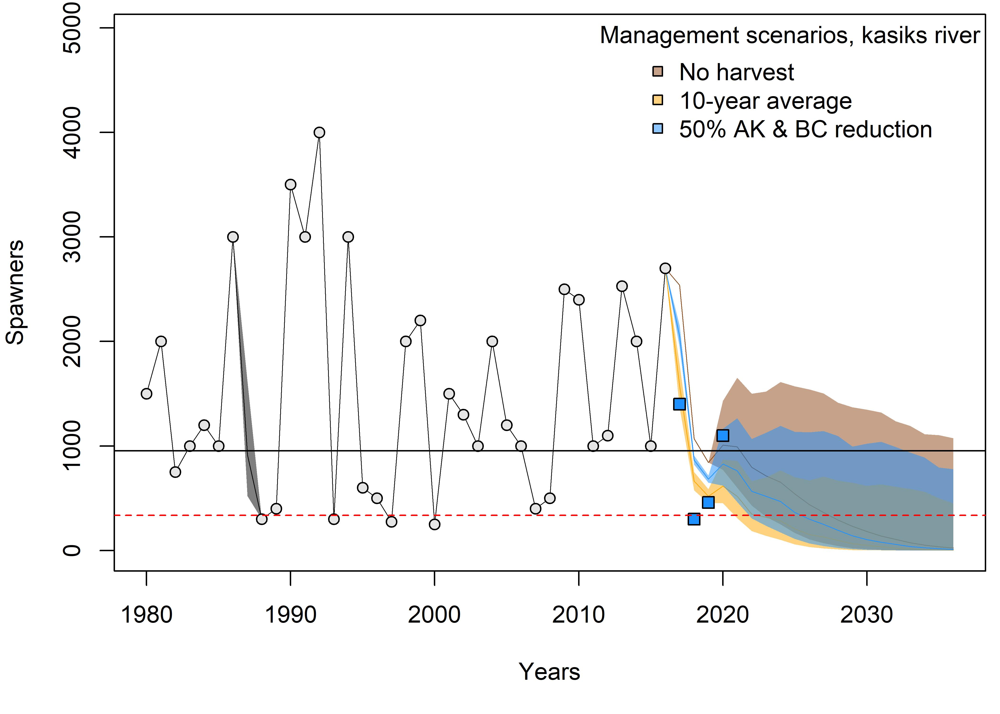
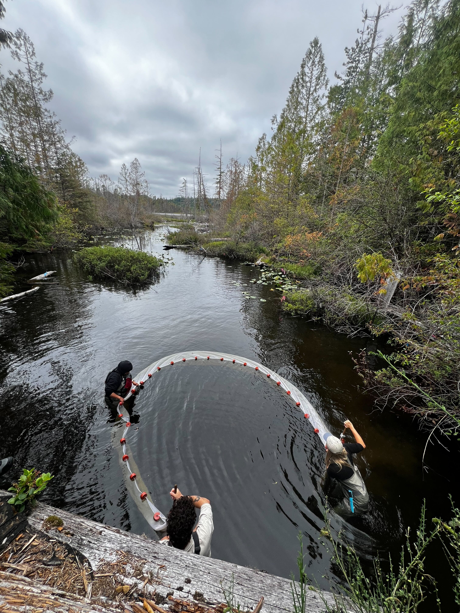
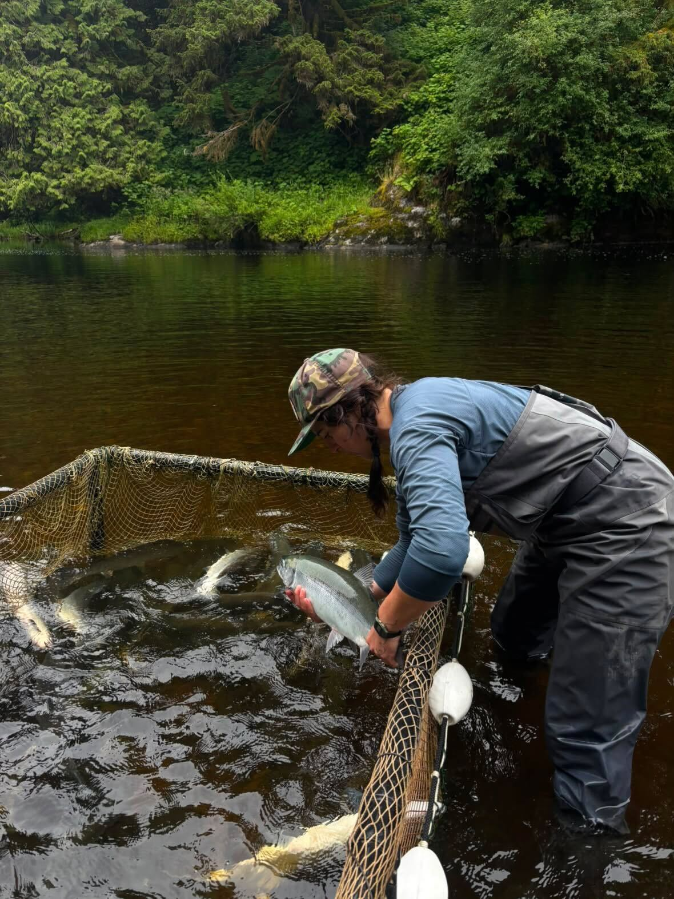
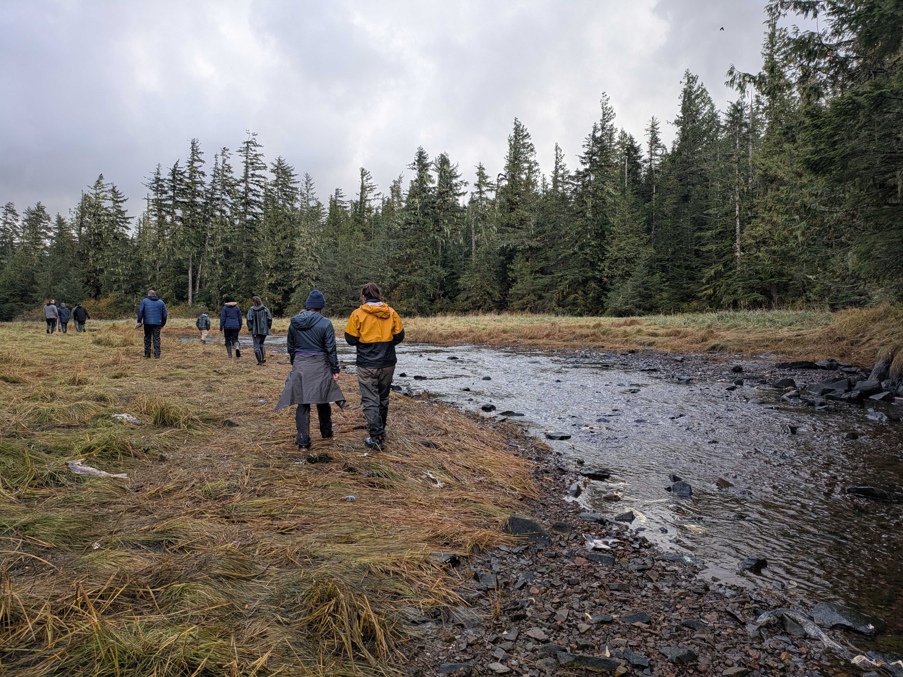
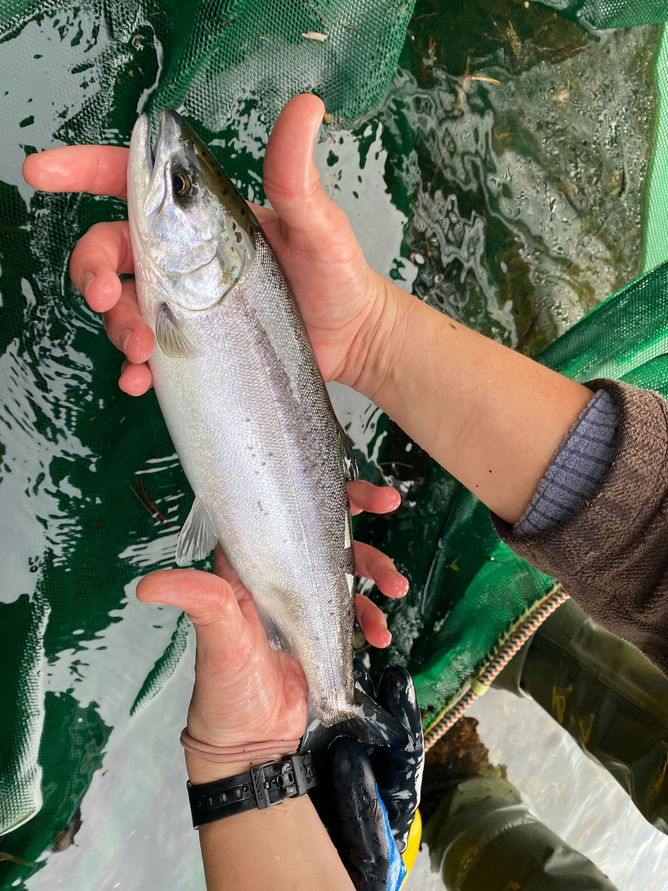

```{=html}
<header class="hero has-photo" style="background-image:url('assets/images/herring-egg.jpg'); --hero-pos:60% 50%">
  <svg class="rivers" data-seed="20231" viewBox="0 0 900 640" preserveAspectRatio="xMidYMax slice" aria-hidden="true"></svg>
  <div class="wrap">
    <div class="hero-body">
      <h1>Understanding risk and resilience in marine, coastal, and freshwater fisheries.</h1>
      <p>We work alongside Indigenous and government partners combining field data, social-ecological theory, and quantitative models to understand risk and resilience in fisheries and work to inform the people and communities who manage them.</p>
      <div class="actions">
        <a class="btn-lab btn-light-lab" href="research/index.html>See our research</a>
        <a class="btn-lab btn-ghost-lab" href="prospective-students/index.html/">Join the lab</a>
      </div>
    </div>
  </div>
  <div class="hero-caption"><i></i>A dendritic metapopulation network.</div>
</header>

<section class="block">
  <div class="wrap split">
    <div>
      <h2>What we study</h2>
      <p class="lede" style="margin-top:1.4rem">Resilient fisheries emerge from feedbacks between fish, people, and managers, all nested within broader social, ecological, and political contexts.</p>
      <a class="textlink" href="research/index.html">More about our research</a>
    </div>
    <ul class="themes">
      <li><svg viewBox="0 0 28 28"><path d="M14 26q-1-4-1-7M13 19q-3-3-6-5M13 19q3-3 5-5" stroke-width="2"/><path d="M7 14q-2-3-4-5M7 14q1-4 2-6M18 14q-1-3-3-6M18 14q3-2 5-4" stroke-width="1.3"/></svg><div><strong>Landscape ecology and life histories of exploited fishes</strong><span>How growth, maturity, and body size vary across lakes, rivers, and coastlines.</span></div></li>
      <li><svg viewBox="0 0 28 28"><path d="M2 5c4.5 0 4 13 9.5 13S17 8 21 8s3.5 10 5.5 13"/><circle cx="11.5" cy="15.2" r="2.8" fill="var(--kelp)" stroke="none"/></svg><div><strong>Risk and resilience in marine and freshwater fisheries</strong><span>Status assessments, reference points, and forward simulations of recovery.</span></div></li>
      <li><svg viewBox="0 0 28 28"><path d="M6.5 11.3A8 8 0 0 1 21.5 11.3"/><path d="M21.5 16.7A8 8 0 0 1 6.5 16.7"/><path d="M18.15 9.11L21.5 11.3 22.67 7.47"/><path d="M9.85 18.89L6.5 16.7 5.33 20.53"/></svg><div><strong>Coupled feedbacks between people and nature</strong><span>Harvesters, managers, and fish as one social-ecological system.</span></div></li>
      <li><svg viewBox="0 0 28 28"><path d="M5 3v20h20"/><path d="M7 6c8 1 12 6 15 15"/></svg><div><strong>Trade-offs in conservation and fisheries management</strong><span>Evidence for decisions that span jurisdictions and governance systems.</span></div></li>
      <li><svg viewBox="0 0 28 28"><<path d="M3 20h22M6 20V12M12 20V7M18 20v-9M24 20V5"/></svg><div><strong>Better fisheries assessment and monitoring</strong><span>Models and survey designs that make the most of limited data.</span></div></li>
    </ul>
  </div>
</section>

<section class="block">
  <div class="wrap">
    <div class="section-head">
      <div>
        <h2>Current projects</h2>
        <p class="lede" style="margin-top:1rem">Some of our current work focuses on marine protected areas, wild salmon conservaton, knowledge pluralism, and integrated quantitative risk assessments.</p>
      </div>
    </div>
    <article class="featured">
      <div class="txt">
        <span class="tag">Salmon</span>
        <h3>Collaborative fisheries management in the Central Coast of Pacific Canada</h3>
        <p>With the Central Coast Indigenous Resource Alliance, we built a Bayesian time-series model of coho populations across the North and Central Coast to identify the role of time-varying producttivity and harvest management in future recovery trajectories. </p>
        <div class="stat">
          <div>52<small>coho populations modelled</small></div>
          <div>51%<small>of populations raised conservation concerns in recent years</small></div>
        </div>
        <a class="textlink" href="research/projects/coho-central-coast.html">Read about this project</a>
      </div>
      <div class="fig">
        
        <p>Coho population dynamics and forward-simulations under alternative scenarios of future harvest management.</p>
      </div>
    </article>
```

::: {#home-projects}
:::

```{=html}
  </div>
</section>

<section class="block">
  <div class="wrap">
    <div class="section-head">
      <h2>News</h2>
      <a class="textlink" href="news/index.html">All news</a>
    </div>
```

::: {#home-news}
:::

```{=html}
  </div>
</section>

<section class="block">
  <div class="wrap">
    <div class="section-head">
      <div>
        <h2>From the field</h2>
        <p class="lede" style="margin-top:1rem">Time on the water, field work, and community visits with our partners.</p>
      </div>
      <a class="textlink" href="news/index.html">More in our news</a>
    </div>
    <div class="photo-strip">
      <figure><figcaption>Hutton Noth (PhD Student) and Michelle Fortier (MRM Student) work with Ha'oom Fisheries Society to survey juvenile coho salmon in the West Coast of Vancouver Island.</figcaption></figure>
      <figure><figcaption>PhD Student Kate Mussett works alongside alongside members of the Heiltsuk Integrated Resource Management Department to survey sockeye salmon at the Koeye River.</figcaption></figure>
      <figure><figcaption>Members of the Fisheries Resources ReconciliationA greement salmon benchmarks subcommitee gather at Kunsoot, Bella Bella, BC to discuss holistic and integrative perspectives of risk to Central Coast salmon.</figcaption></figure>
      <figure><figcaption>Hutton Noth (PhD Student) and staff from Ha'oom Fisheries Society survey juvenile salmon in the Kennedy Watershed on the West Coast of Vancouver Island.</figcaption></figure>
    </div>
  </div>
</section>

<section class="block">
  <div class="wrap">
    <h2>Partners and collaborators</h2>
    <p class="lede" style="margin-top:1rem">We work alongside Indigenous partners, government researchers, and research groups across Canada.</p>
    <ul class="partners-list">
      <li><strong>Central Coast First Nations</strong><span>Coastal and marine stewardship, co-governance</span></li>
      <li><strong>Central Coast Indigenous Resource Alliance</strong><span>Salmon, crab, and groundfish ecology and management</span></li>
      <li><strong>Ha'oom Fisheries Society</strong><span>Salmon and spot prawn ecology and management</span></li>
      <li><strong>Fisheries Management Lab</strong><span>SFU School of Resource and Environmental Management</span></li>
      <li><strong>Salmon Watersheds Lab</strong><span>Metapopulations and disturbance, SFU</span></li>
      <li><strong>COSEWIC</strong><span>Marine Fishes Species Specialist Subcommittee</span></li>
    </ul>
  </div>
</section>

<section class="block" style="padding-bottom:6rem">
  <div class="wrap">
    <div class="join">
      <div>
        <h2>Join the lab</h2>
        <p class="lede" style="margin-top:1.2rem">We welcome curious, collaborative people from all backgrounds that are especially motivated to work at the intersection between quantitative ecology, Indigenous-led stewardship, and marine policy.</p>
        <p style="margin-top:2rem"><a class="btn-lab btn-dark-lab" href="prospective-students/index.html">Information for prospective students</a></p>
      </div>
      <ul>
        <li><strong>Graduate students</strong><span>Master's and PhD positions through SFU REM.</span></li>
        <li><strong>Postdoctoral fellows</strong><span>We're happy to support scholarship and fellowship applications.</span></li>
        <li><strong>Undergraduates</strong><span>Research assistant and honours projects.</span></li>
      </ul>
    </div>
  </div>
</section>
```
