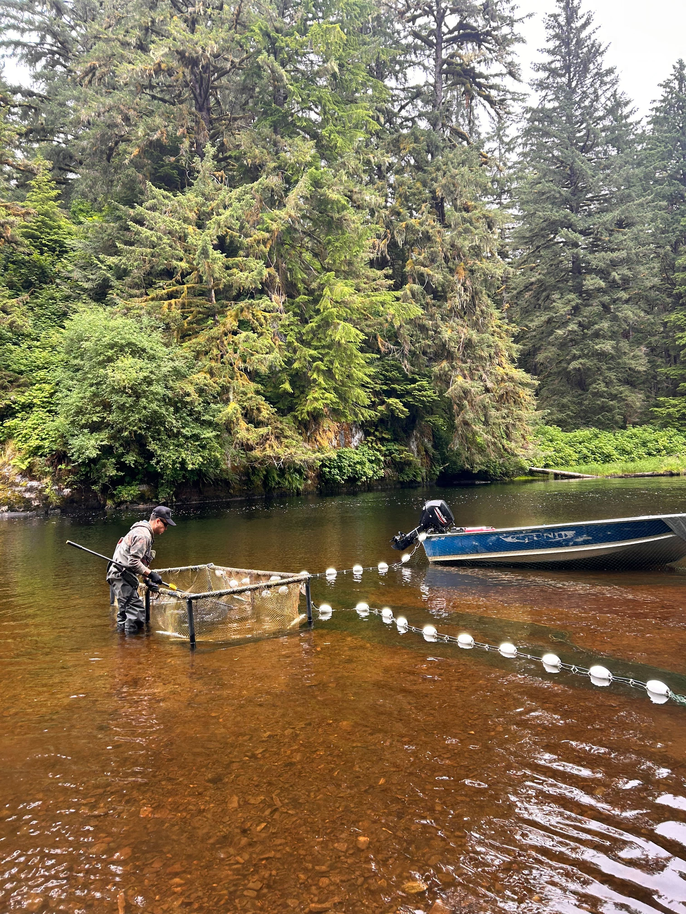

::: {.wrap .prose style="padding-bottom:6rem"}

Kate Mussett (PhD Student) and Lindsay Begemann (MRM Student) join the weir crew at the Koeye River to help monitor and survey returning sockeye salmon to Heiltsuk Territory.

:::
