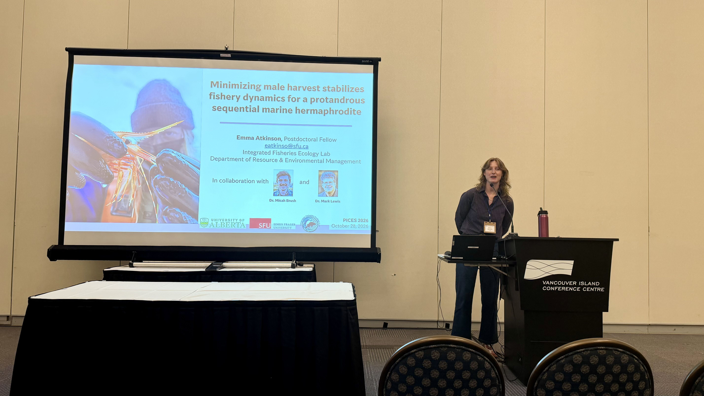
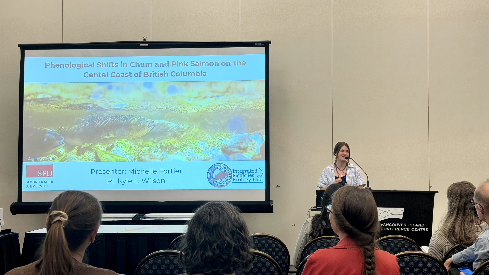
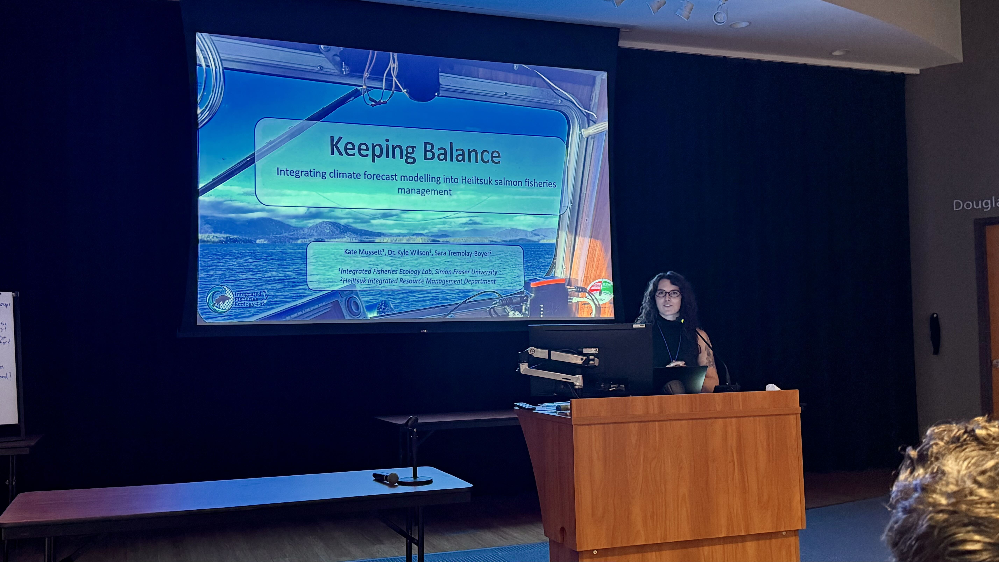
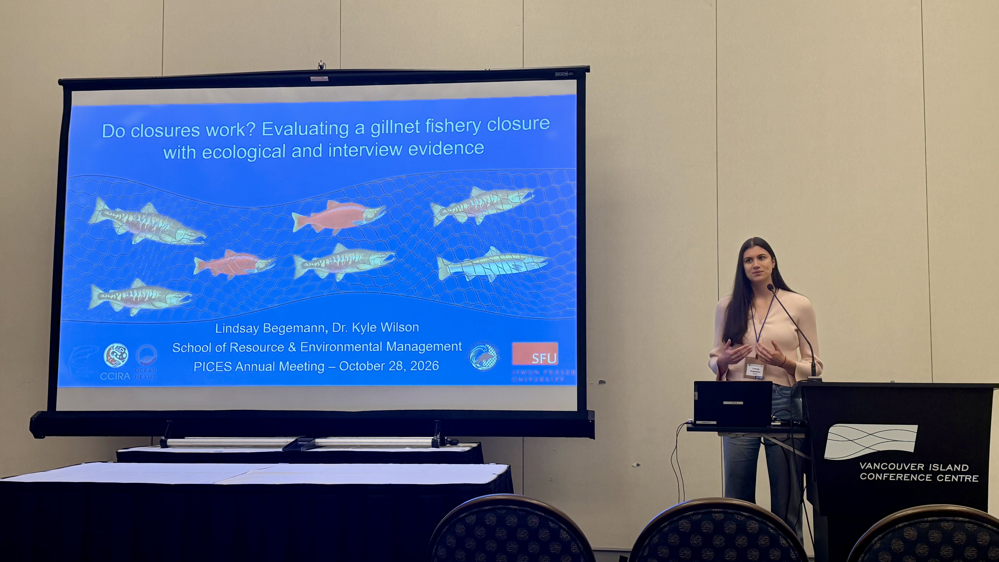

::: {.wrap .prose style="padding-bottom:6rem"}

Some folks from the lab travelled to Nanaimo to present some of our research at the [PICES 2026 Annual Meeting](https://meetings.pices.int/meetings/annual/2026/PICES/venue) at the Vancouver Island Conference Centre, joining ocean scientists from across the North Pacific.

<!-- Captions and photo credits: add a <figcaption> inside any figure below if you want one. -->
```{=html}
<div class="photo-strip" style="grid-template-columns:repeat(2,minmax(0,1fr))">
  <figure></figure>
  <figure></figure>
  <figure></figure>
  <figure></figure>
</div>
```

**Emma Atkinson** presented some work from her PhD on spot prawn life cycle dynamics.

**Kate Mussett** presented her research on Pacific salmon in Heiltsuk Territory.

**Lindsay Begemann** presented her work on the consequences of salmon fishery closures in the Central Coast.

**Michelle Fortier** presented her research on shifts in pink and chum salmon migration timing in the Central Coast.

Photo credits to **Hutton Noth**, who also joined up for the conference.

PICES was a great forum to showcase some of our more regional and local work to folks that work across the North Pacific.

:::
