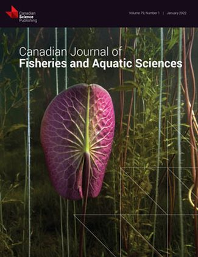
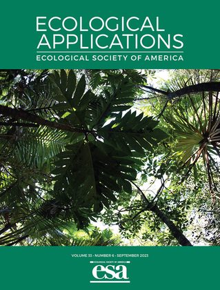
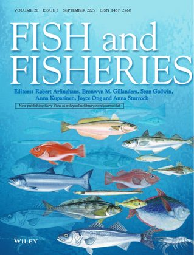
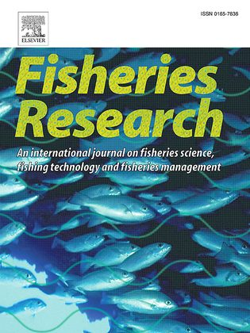
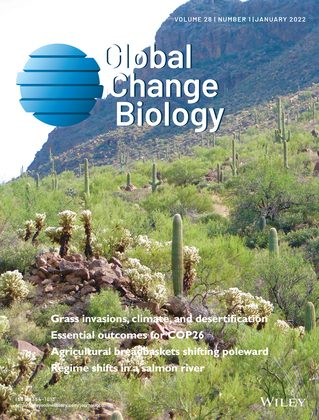

```{=html}
<header class="page-head has-shelf">
  <div class="wrap">
    <div>
      <h1>Papers</h1>
      <p>Lab members are shown in bold. Code and data for most papers are shared openly on GitHub.</p>
    </div>
    <!-- Journal covers. Images live in papers/covers/. Add or remove a line to change
         the shelf; four or five looks best. A cover can be plain, or wrapped in a link
         to the paper in that issue (see the last one). -->
    <div class="shelf">
      <a href="https://doi.org/10.1139/cjfas-2025-0023">
      <a href="https://doi.org/10.1002/eap.2898">
      <a href="https://doi.org/10.1111/faf.12778">
      <a href="https://doi.org/10.1016/j.fishres.2024.107102">
      <a href="https://doi.org/10.1111/gcb.15895"></a>
    </div>
  </div>
</header>

<div class="wrap">
  <div class="paper-tools">
    <div class="filters" data-target="#listing-papers" role="group" aria-label="Filter papers by topic">
      <button class="chip" data-f="all" aria-pressed="true">All</button>
      <button class="chip" data-f="salmon" aria-pressed="false">Salmon</button>
      <button class="chip" data-f="groundfish" aria-pressed="false">Groundfish</button>
      <button class="chip" data-f="freshwater" aria-pressed="false">Freshwater</button>
      <button class="chip" data-f="people" aria-pressed="false">People &amp; policy</button>
      <button class="chip" data-f="theory" aria-pressed="false">Theory &amp; methods</button>

    </div>
    <input id="paperSearch" class="paper-search" type="search" placeholder="Search titles, authors, journals" aria-label="Search papers">
  </div>
```

::: {#papers}
:::

```{=html}
  <p style="margin:1rem 0 6rem"><a class="textlink" href="https://scholar.google.ca/citations?user=JQtrxYAAAAAJ&hl=en">Full list on Google Scholar</a></p>
</div>
```
