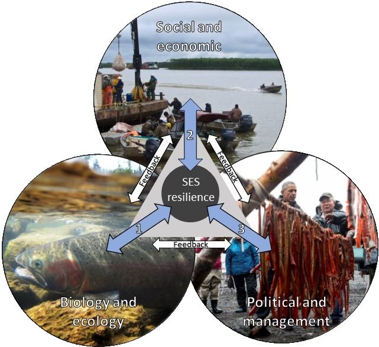

```{=html}
<header class="page-head">
  <svg class="rivers" data-seed="7781" data-animate="false" viewBox="0 0 900 640" preserveAspectRatio="xMidYMax slice" aria-hidden="true"></svg>
  <div class="wrap">
    <h1>Research</h1>
    <p>We integrate field and quantitative approaches to understand the social and ecological drivers of risk and resilience in fisheries.</p>
  </div>
</header>

<section class="block" style="padding-top:1rem">
  <div class="wrap split">
    <div>
      <h2>Our approach</h2>
      <div class="prose" style="margin-top:1.4rem">
        <p>Combining empirical and theoretical approaches is a powerful way to tackle questions in basic and applied ecology. Our work sits at the interface of quantitative ecology, population dynamics, life-history theory, risk assessment, spatial ecology, human dimensions, and environmental policy.</p>
        <p>We work alongside Indigenous partners and government researchers to produce evidence that bridges science and policy, supporting management frameworks that advance reconciliation, respect Indigenous sovereignty, and promote resilient ecosystems.</p>
      </div>
      <div class="loop">
        
        <p>Fishery resilience emerges from behavioural feedbacks between fish, people, and management. Adapted from Ward et al. (2016).</p>
      </div>
    </div>
    <div>
    <div>
      <h2 style="font-size:1.6rem;margin-bottom:1.2rem">Research themes</h2>
      <ul class="themes">
        <li><svg viewBox="0 0 28 28"><path d="M14 26q-1-4-1-7M13 19q-3-3-6-5M13 19q3-3 5-5" stroke-width="2"/><path d="M7 14q-2-3-4-5M7 14q1-4 2-6M18 14q-1-3-3-6M18 14q3-2 5-4" stroke-width="1.3"/></svg><div><strong>Landscape ecology and life histories of exploited fishes</strong><span>How growth, maturity, and body size vary across lakes, rivers, and coastlines.</span></div></li>
      <li><svg viewBox="0 0 28 28"><path d="M2 5c4.5 0 4 13 9.5 13S17 8 21 8s3.5 10 5.5 13"/><circle cx="11.5" cy="15.2" r="2.8" fill="var(--kelp)" stroke="none"/></svg><div><strong>Risk and resilience in marine and freshwater fisheries</strong><span>Status assessments, reference points, and forward simulations of recovery.</span></div></li>
      <li><svg viewBox="0 0 28 28"><path d="M6.5 11.3A8 8 0 0 1 21.5 11.3"/><path d="M21.5 16.7A8 8 0 0 1 6.5 16.7"/><path d="M18.15 9.11L21.5 11.3 22.67 7.47"/><path d="M9.85 18.89L6.5 16.7 5.33 20.53"/></svg><div><strong>Coupled feedbacks between people and nature</strong><span>Harvesters, managers, and fish as one social-ecological system.</span></div></li>
      <li><svg viewBox="0 0 28 28"><path d="M5 3v20h20"/><path d="M7 6c8 1 12 6 15 15"/></svg><div><strong>Trade-offs in conservation and fisheries management</strong><span>Evidence for decisions that span jurisdictions and governance systems.</span></div></li>
      <li><svg viewBox="0 0 28 28"><<path d="M3 20h22M6 20V12M12 20V7M18 20v-9M24 20V5"/></svg><div><strong>Better fisheries assessment and monitoring</strong><span>Models and survey designs that make the most of limited data.</span></div></li>
      </ul>
    </div>
  </div>
</section>

<section class="block">
  <div class="wrap">
    <div class="section-head">
      <h2>Projects</h2>
      <div class="filters" data-target="#listing-projects" role="group" aria-label="Filter projects by system">
        <button class="chip" data-f="all" aria-pressed="true">All</button>
        <button class="chip" data-f="salmon" aria-pressed="false">Salmon</button>
        <button class="chip" data-f="groundfish" aria-pressed="false">Groundfish</button>
        <button class="chip" data-f="freshwater" aria-pressed="false">Freshwater</button>
        <button class="chip" data-f="people" aria-pressed="false">People &amp; policy</button>
        <button class="chip" data-f="theory" aria-pressed="false">Theory</button>
      </div>
    </div>
```

::: {#projects}
:::

```{=html}
  </div>
</section>
<div style="height:5rem"></div>
```
