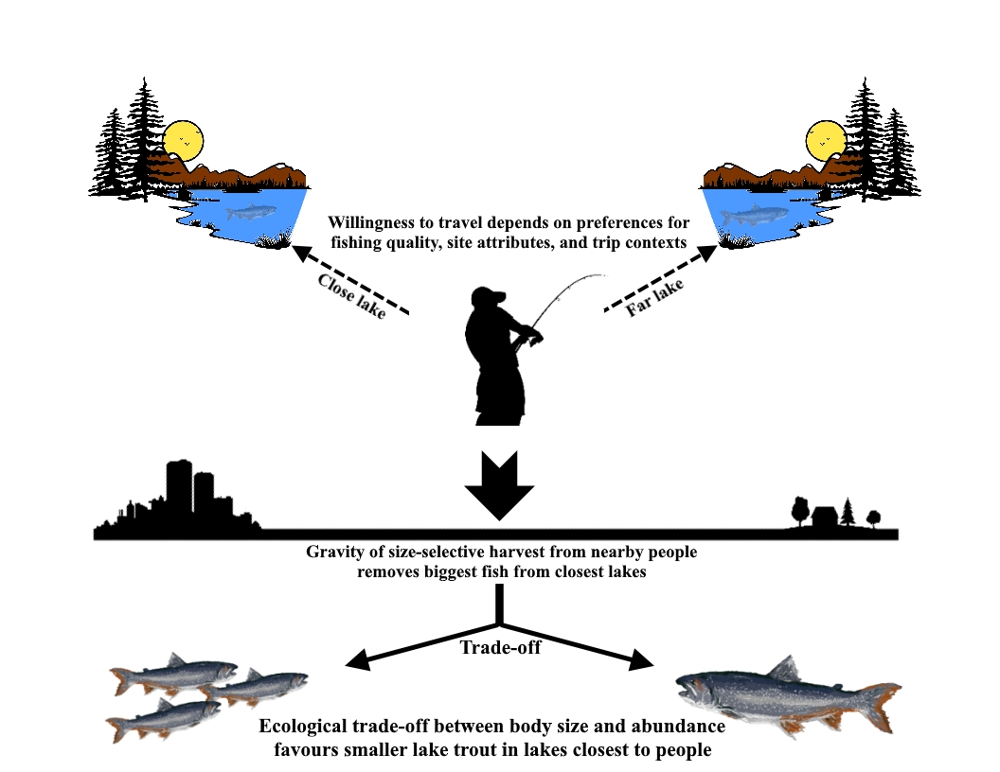

```{=html}
<header class="page-head">
  <div class="wrap">
    <p style="margin:0 0 1rem;font-family:inherit;font-size:.95rem"><a href="../index.html" style="color:#C3D8D6">Research</a></p>
    <h1>Life-history diversity in Canada's lake trout</h1>
    <div class="meta-strip">
      <div><b>System</b>Freshwater lakes</div>
      <div><b>Partners</b>BC provincial fisheries data</div>
      <div><b>Status</b>Open to a student — no current funding</div>
    </div>
  </div>
</header>
```

::: {.wrap}
::: {.prose}

In 2008 and 2009, BC provincial fisheries staff sampled 30 lake trout populations, from large exploited lakes to pristine backcountry and high-alpine ones, and collected back-calculated size-at-age from 1,100 fish. Those fish ranged enormously in size, with several over 100 cm, and in age, with many born in the 1950s.



Earlier work from this dataset showed that warming temperatures, higher lake productivity and increased harvest can all raise somatic growth rates, but that energetic trade-offs between growth and reproduction limit population resilience — and that where people can reach a lake easily, size-selective harvest produces a measurable halo of depletion, favouring smaller fish closest to population centres.

## What is still open

Throughout their range, lake trout show large- and small-bodied morphs tied to diet or post-glacial evolution. These polymorphs may be a distinct contribution to both fisheries and biodiversity conservation, and the dataset can still answer:

- Are polymorphs present across these 30 lakes, and how many morphs are there? A bioenergetic von Bertalanffy model can test whether a given fish belongs to one morph or another.
- What drives variation in growth over time? Time series of climate and fishery infrastructure development can locate when, by age or by year, growth conditions changed.

::: {.callout-lab}
### Looking for a student

This project has no current funding and is not an active priority of the lab, but the data are in hand and the questions are good. If you are a prospective student interested in freshwater life-history variation and want to build a thesis around it, [get in touch](../../prospective-students/index.html#get-in-touch).
:::

:::
:::

`<div style="height:5rem"></div>`{=html}
