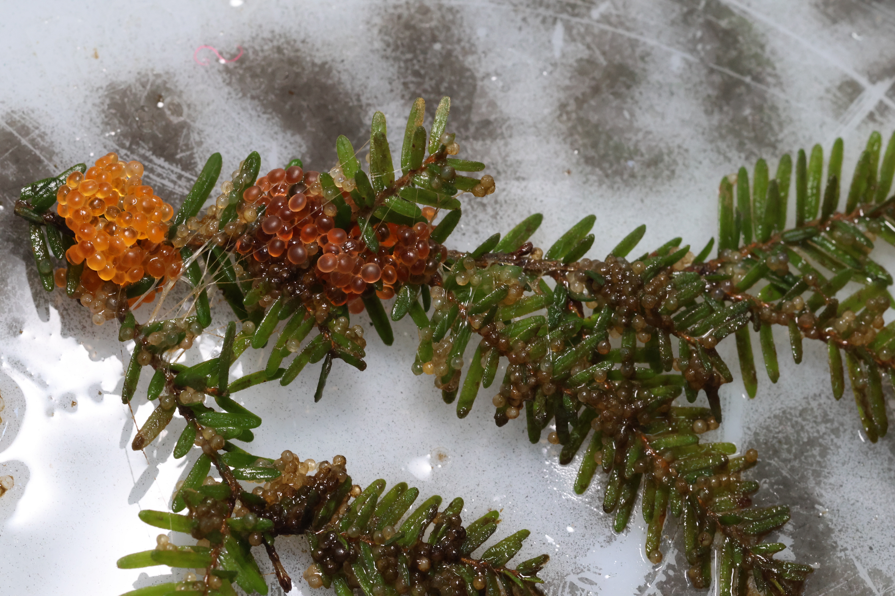

```{=html}
<header class="page-head">
  <div class="wrap">
    <p style="margin:0 0 1rem;font-family:inherit;font-size:.95rem"><a href="../index.html" style="color:#C3D8D6">Research</a></p>
    <h1>Git Qṃsistá: revitalising herring ecosystems in a warming sea</h1>
    <div class="meta-strip">
      <div><b>System</b>Pacific herring</div>
      <div><b>Partners</b>Kitasoo Xai'xais First Nation, KXSA, DFO, Oceana Canada, UVic</div>
      <div><b>Status</b>Active</div>
    </div>
  </div>
</header>
```

::: {.wrap}
::: {.prose}

*Git Qṃsistá* means "People of the Moon Tipped Over" — the Kitasoo Xai'xais name for March, when the herring return. The name was given to this project by Sierra Hall and Doug Neasloss, and joins the Kitasoo (Sguuxs) and Xai'xais languages, as the two peoples are joined into one Nation.



Pacific herring are a forage fish and a cultural keystone species. They feed much of the coastal food web, they provision traditional foods at Potlatches, they carry intergenerational knowledge transfer to youth, and they underpin inter-Nation trade and a commercial spawn-on-kelp harvest.

Regional herring abundance on the Central Coast has declined from its 1980 peak, with low productivity through 2005–2014 and again in 2021–2024. Abundance at Kitasu Bay — the main Kitasoo Xai'xais harvesting area — has stayed higher, which likely reflects Kitasoo Xai'xais stewardship. But the Nation is concerned about shrinking spawning extent, about surf scoters aggregating above historical levels and eating eggs, and about what warming does to herring resilience.

## What we are working on

**Egg transplants.** Kitasoo Xai'xais youth, Elders, herring fishers, knowledge holders and Stewardship Authority staff set hemlock boughs, await the spawn, and move the egg-laden boughs into spawning sites that have been depleted for a long time. The practice is a long-standing one among coastal First Nations; the project operationalises it and tracks whether transplanted sites re-establish.

**Predation.** We track surf scoter numbers and monitor egg loss in spawning areas, then build bioenergetic and predator–prey models to quantify how much mortality predation actually causes.

**Knowledge weaving and management.** We are compiling Kitasoo Xai'xais knowledge of herring and stewardship practice and pairing it with scientific methods that address different spatial scales of management. The intent is a joint Kitasoo Xai'xais–DFO management plan for herring, built on knowledge co-produced through the project, and performance metrics and benchmarks that reflect ecosystem states Kitasoo Xai'xais actually want.

## Why it matters

This work sits inside the Gitdisdzu Lugyeks (Kitasu Bay) Marine Protected Area, declared under Kitasoo Xai'xais law and now part of the Mia-yaltwa Ha'lidzogm hoon National Marine Conservation Area Reserve. Every decision runs through technical staff at the Kitasoo Xai'xais Stewardship Authority and the Nation's Marine Working Group of Hereditary Chiefs, harvesters, knowledge holders, Matriarchs and political leadership.

:::
:::

`<div style="height:5rem"></div>`{=html}
