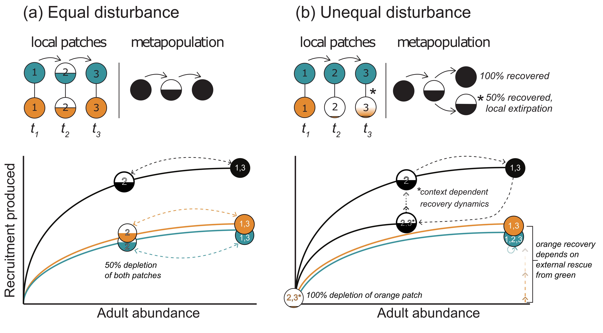
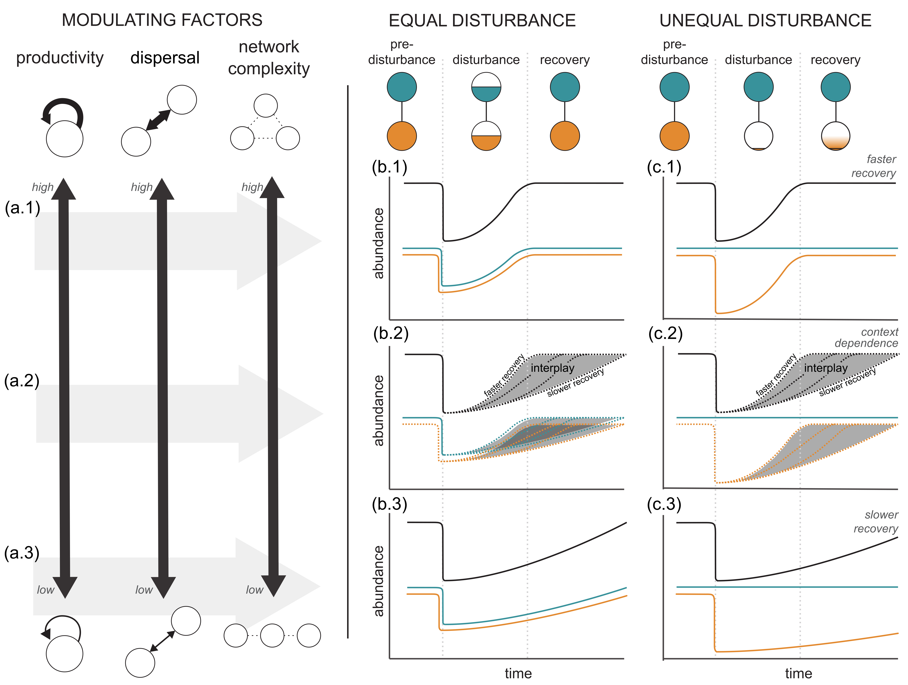

```{=html}
<header class="page-head">
  <div class="wrap">
    <p style="margin:0 0 1rem;font-family:inherit;font-size:.95rem"><a href="../index.html" style="color:#C3D8D6">Research</a></p>
    <h1>Scale transitions in population dynamics</h1>
    <div class="meta-strip">
      <div><b>System</b>Population and metapopulation theory</div>
      <div><b>Partners</b>Salmon Watersheds Lab SFU, Central Coast Management Council</div>
      <div><b>Status</b>Active — open to students</div>
    </div>
  </div>
</header>
```

::: {.wrap}
::: {.prose}

The processes that govern a fish population — density-dependent growth and survival, dispersal, local mortality — operate at the scale of a stream reach or a reef. The quantities we actually model, monitor and manage are aggregates: a conservation unit, a stock, a management area. Moving between those two scales is not a matter of averaging. Because local processes are nonlinear, the dynamics of the aggregate are systematically *not* the dynamics of its average component. That discrepancy is the **scale transition**, and it is one of the deep structural problems in population ecology.



## What we have shown

We built a general model of how the behaviour of a spatially structured population emerges from the interplay between local dynamics, spatial disturbance and regional dispersal. Whether a disturbance is spread evenly across local patches or concentrated on a few changes the aggregate recovery substantially, and productivity, dispersal and network topology each modulate that outcome. This helps explain why some depleted populations — Chinook salmon, California sea otters, Snake River stocks — recover more slowly than their aggregate demography predicts.



> Wilson KL, Sawyer A, Potapova A, Bailey CJ, LoScerbo D, Sweeney-Bergen EK, Hodgson EE, Pitman KJ, Seitz K, Law L, Warkentin L, Wilson SM, Atlas WI, Braun DC, Sloat M, Tinker MT, Moore JW. 2023. The role of spatial structure in at-risk metapopulation recoveries. *Ecological Applications* 33: e2898.

## Open questions

Our working theoretical framework is published; but many of the consequences are still not worked out. We are interested in:

- **Aggregated stock and recruitment.** A stock–recruitment relationship fitted to an aggregate is a mixture of local relationships that differ in productivity, capacity and connectivity. What does its shape actually represent, and when does it mislead?
- **Emergent compensation.** Compensation measured on the aggregate need not be the compensation operating anywhere in particular. This connects directly to our work on [resilience in exploited populations](resilience-theory.html), where compensation is built from the individual upward rather than fitted from the top down.
- **Non-stationary connectivity.** Dispersal and habitat networks are themselves changing. How do recovery expectations shift when the network is not fixed?
- **What scale should we assess at?** Status at the population, watershed and regional scale can disagree with each other and still all be correct. Deciding which one a management action should answer to is a scientific question as much as a policy one.

We are pursuing these through retrospective analyses of Central Coast coho demography at population, watershed and regional scales, and through simulations that test whether management strategies hold populations above reference points at *every* scale rather than only the one being reported.

This is a strand of the lab with more good questions than people, and the theory travels well beyond salmon. If you are a prospective student drawn to spatial population dynamics, [get in touch](../../prospective-students/index.html#get-in-touch).

:::
:::

`<div style="height:5rem"></div>`{=html}
